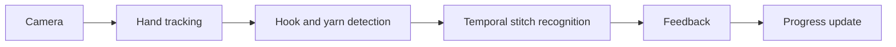

# Crochet Field Lab 🧶

A browser-based beginner crochet course with guided steps, an illustrative 3D-coordinate stitch view, an on-device camera, optional hand landmarks, manual stitch tracking, and local progress. This repository is the working prototype for that idea — not a finished computer-vision tutor.

The prototype covers the first learning loop: follow a step, watch the stitch motion, practice in front of the camera, count your stitches, and keep your place. Automatic stitch recognition and AI correctness feedback remain research work.

## Quick start

Requirements: a modern browser; Node.js 20 or newer for the build and smoke test; Python 3 for the no-build preview.

No build step is needed to preview the site:

```bash
python3 -m http.server 8000
npm test
```

Open `http://localhost:8000/`. For camera access from a phone, deploy over HTTPS first; a plain `http://<LAN-IP>` page may be refused by the browser.

## What works today

- **Guided course:** eight steps from tools and slip knot through foundation chain, single crochet, rows, and fastening off.
- **Illustrative stitch view:** rotatable and zoomable canvas scenes drawn from 3D coordinates. These are explanatory illustrations, not physically accurate crochet simulations or models generated from camera input.
- **Camera practice:** on-device preview with front/back switch, plus an opt-in MediaPipe Hand Landmarker overlay that reports whether hands are in frame. Model and WebAssembly assets load from an external CDN only when enabled.
- **Manual tracking:** foundation-chain and single-crochet counters, undo, row number and next-row control, lesson check-offs, self-check and tips, and an activity journal.
- **Persistence:** pause, resume, and automatic `localStorage` saves in the same browser profile. No cross-device sync.
- **Agent tools:** eight optional WebMCP tools over the same lesson actions. See [Optional WebMCP tools](#optional-webmcp-tools).
- **Responsive UI:** phone layout, keyboard rotation for the stitch view, reduced-motion handling, and chapter links to the source tutorial.

No automatic stitch counting, stitch-correctness detection, hook position detection, or yarn tracking exists.

## Concept and goals

The long-term product is a crochet companion that helps a beginner learn independently:

- **Learn** fundamental techniques from step-by-step animated guidance.
- **Practice** with a camera that observes real hand and hook movement.
- **Get feedback** on stitch sequences, mistakes, and corrections.
- **Track** stitches, rows, completed steps, and project history.
- **Pause and resume** without losing the learner's place.

Today the app delivers learning, manual tracking, and local resume. Camera hand framing is available; smart feedback is not.

Full product specification: [`docs/SPEC.md`](docs/SPEC.md).

## Curriculum

The course follows the topics and chapter links in [simplydaisy's introductory crochet lesson](https://www.youtube.com/watch?v=aAxGTnVNJiE):

`00:23` materials · `00:53` slip knot · `01:15` holding hook · `01:52` chain · `03:35` single crochet · `07:02` weave in ends.

The eight app steps and the 11-chain practice are an **app curriculum**, not a transcript of the video. No footage, graphics, or source code from the reference sites is copied or rehosted.

US terminology: `ch` = chain, `sc` = single crochet. A *slip knot* is not a *slip stitch*. Double crochet (`dc`) is beyond the first course.

## Technical exploration

Proposed recognition pipeline:



| Technology | Purpose | In prototype |
|---|---|---|
| Three.js / WebGL | Interactive 3D crochet visualization | No — Canvas 2D projection of 3D coordinates |
| MediaPipe Hands | Hand landmark tracking | Yes — optional, framing only |
| Object detection / segmentation | Identify hook, yarn, and loops | No |
| Temporal action recognition | Identify movements and completed stitches | No |
| VLM / LLM | Context-aware mistake explanation | No — static lesson tips |
| State machine | Validate order and manage progress | Partial — lesson and counter state; no action validation |
| Browser storage / IndexedDB | Persist progress and history | Yes — `localStorage` only |

**Research challenge:** accurate stitch recognition requires tracking small, frequently occluded yarn and hook movements over time. Hand landmarks alone cannot establish stitch correctness. A recognizer needs consented multi-angle clips, action-phase labels, hook/yarn tracking, temporal smoothing, an explicit *not sure* result, and evaluation on unseen learners. A low-confidence result must never silently advance a learner.

See [`docs/ARCHITECTURE.md`](docs/ARCHITECTURE.md) for the current runtime and the proposed computer-vision extension.

## Roadmap and MVP

| Phase | Focus | Prototype status |
|---|---|---|
| **P0 — Fundamental course** | Illustrations, beginner instructions, navigation, mobile UX | Started — eight steps and responsive UI |
| **P1 — Progress tracking** | Counting, undo, checkpoints, pause/resume | Started — manual counts, rows, pause/resume, journal |
| **P2 — Computer vision** | Calibration, hand tracking, hook/yarn detection | Partial — camera preview and optional hand landmarks |
| **P3 — Stitch recognition** | Temporal recognition, automatic counting, error detection | Not started |
| **P4 — AI tutor** | Personalized feedback, explanations, voice | Not started |
| **P5 — Product expansion** | Pattern import, pattern-to-3D, amigurumi, community | Not started |

MVP scope:

1. **Deliver the beginner course:** functional guidance, camera preview, and persistent progress. The current prototype covers this with illustrative rather than physically accurate 3D.
2. **Run one bounded CV experiment:** recognize foundation-chain movements and measure stitch-count accuracy across users, camera angles, and yarn types.
3. **Keep the manual path primary** until recognition meets the evaluation bar above.

Detailed phases and exit criteria: [`docs/ROADMAP.md`](docs/ROADMAP.md).

## Architecture

```
Camera (getUserMedia) ───────► video panel
              └─ opt-in hand landmarker (MediaPipe) ► hand landmark overlay

Lesson manifest ─────► chapter-linked tutorial + illustrative stitch viewport
          └──────► next actions + manual self-check
Manual counter ─────► localStorage ◄──── lesson navigation / pause
                                └──────► history + resume

Browser agent ─────► document.modelContext ► webmcp.js ──► same actions + UI
```

## Files

- `index.html` — semantic layout
- `styles.css` — design tokens and responsive UI; Google Fonts are optional
- `app.js` — lesson content, progress, canvas stitch renderer, camera, optional hand landmarks
- `webmcp.js` — optional WebMCP tool definitions built on the same app actions
- `vendor/webmcp-polyfill.js` — vendored W3C WebMCP polyfill 0.1.0 (Apache-2.0; license beside it)
- `scripts/build-static.mjs` — copies browser assets into `dist/` for Workers
- `wrangler.toml` — Cloudflare Workers static-assets configuration
- `tests/test-smoke.cjs` — Node smoke test for navigation, counts, persistence, and journal
- `docs/SPEC.md` — product concept, goals, core features, roadmap, and MVP scope
- `docs/ARCHITECTURE.md` — current runtime and proposed computer-vision extension
- `docs/ROADMAP.md` — phased roadmap with prototype status
- `docs/tests/` — browser E2E evidence for the UI and deployment changes
- `.omp/skills/pr-e2e-evidence/` — repository-local E2E evidence workflow

## Optional WebMCP tools

The page registers eight tools through `document.modelContext` from the [WebMCP draft](https://webmachinelearning.github.io/webmcp/). Where the browser already provides native WebMCP, registration goes to that native context. Elsewhere, `vendor/webmcp-polyfill.js` (the W3C [`@w3c/webmcp-polyfill@0.1.0`](https://github.com/w3c-oss/webmcp-polyfill), Apache-2.0) installs the API for in-page agents and same-origin frames. A browser-integrated agent still needs native support; the polyfill cannot add it.

WebMCP is a Community Group draft, not a W3C Standard. Both the draft and the polyfill can change.

| Tool | Access | Effect |
|---|---|---|
| `get-crochet-progress` | read-only | Current lesson, counter, totals, completion, recent journal entries |
| `list-crochet-lessons` | read-only | All eight lessons with 1-based numbers, phases, and targets |
| `open-crochet-lesson` | write | Switches lesson and returns to the learning view |
| `adjust-stitch-count` | write | Adds/removes foundation chains (lesson 5) or single crochet (lessons 6–7) |
| `finish-crochet-row` | write | Ends the current single-crochet row and starts the next |
| `complete-crochet-lesson` | write | Marks the lesson done and advances; last lesson opens the journal |
| `open-crochet-journal` | write | Shows totals and the activity log |
| `self-check-crochet-stitch` | write | Records the learner's "looks good" or "need a tip" choice and returns coaching text |

Every tool reuses the button handlers, so the visible UI and `localStorage` stay in sync. Tools reject calls while the session is paused or while the journal view is open (except the two read-only tools, which always answer), and `adjust-stitch-count` refuses a stitch type the current lesson does not count. `self-check-crochet-stitch` records the learner's claim; it does not inspect stitches or verify correctness. No tool turns the camera on or reads video.

The vendored polyfill is the package's standalone `dist/polyfill.js`. Replace that one file to update it, keeping `vendor/webmcp-polyfill.LICENSE` in sync.

## Deploy to Cloudflare Workers

The site deploys as a static-assets-only Worker. `npm run build` copies `index.html`, `styles.css`, `app.js`, `webmcp.js`, and `vendor/` into `dist/`; `wrangler.toml` serves that directory.

One-time local setup:

```bash
npm ci
npx wrangler login
```

Build, inspect, and publish:

```bash
npm run build
npm run deploy:dry     # validate config without publishing
npm run dev            # http://localhost:8787
npm run deploy         # build and publish the Worker
```

### Cloudflare Workers Builds

Connect `kaylaque/crochetfieldlab` in the Cloudflare dashboard, then use these settings:

| Setting | Value |
|---|---|
| Production branch | `cf-pages` |
| Build command | `npm run build` |
| Deploy command | `npx wrangler deploy` |
| Root directory | `/` |

`cf-pages` is a deployment branch, not a Cloudflare Pages project. It gates deployments, so ordinary commits on `main` do not trigger a build. The branch contains a build-trigger commit that is not on `main`, so merge instead of requiring a fast-forward:

```bash
git fetch origin
git switch cf-pages
git merge origin/main
git push origin cf-pages
```

The GitHub app authorizes the build; no Cloudflare token is stored in this repository. For a token-based runner instead, set `CLOUDFLARE_API_TOKEN` and `CLOUDFLARE_ACCOUNT_ID` in that runner's secrets. For a direct deploy without Workers Builds, run `npm run deploy` after `npx wrangler login`.

For a manual rebuild, create a Deploy Hook for `cf-pages` under **Settings → Builds → Deploy Hooks** and POST to its URL.

## References

| Reference | Inspiration |
|---|---|
| [ESP32 Field Lab](https://ardchain.github.io/esp32-field-lab/) | Guided-learning UX, step navigation, visual controls |
| [Garis Tepi Cangkang](https://bsw.kadcom.dev/trik/garis-tepi-cangkang/) | Stylized outline rendering and visual design direction |
| [Beginner crochet tutorial](https://youtu.be/aAxGTnVNJiE) | Course topics, sequence, and chapter timestamps |
| [CrochetPARADE](https://crochetparade.org/) | Procedural crochet modeling and stitch animation — future work |
| [Yarnify3D](https://yarnify3d.com/) | Live 3D pattern preview — future work |
| [Crochet Slicer](https://nordiclayerlab.se/) | Model-to-pattern conversion — future work |

These links are references, not assets. This prototype is an original implementation.

## Privacy and limitations

- Video is displayed locally through the browser camera API. The app does not upload or record frames.
- Enabling optional hand tracking fetches JavaScript, WebAssembly, and model weights from jsDelivr and Google Storage. Browser privacy practices apply to those requests.
- Progress is stored only in `localStorage` and is subject to browser storage policies, deletion, private browsing, and device changes.
- The WebMCP tools expose lesson progress, stitch counts, and journal entries to the agent the browser provides. They do not expose video, camera controls, or `getUserMedia`, and they make no network requests.
- A learner can mark a lesson complete without mastering it; the interface does not present an unsupported automatic correctness score.
- The stitch visuals are original procedural illustrations, not a copy of CrochetPARADE or the linked design references.
