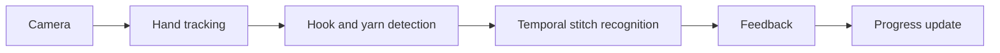

# Crochet Field Lab — product specification

Status: prototype v1. The implementation covers the learning loop and manual progress; computer-vision feedback remains research work.

## 1. Concept

Crochet Field Lab is a browser-based, camera-assisted crochet companion for beginners. It combines guided lessons, an illustrative stitch view, camera practice, manual tracking, and local progress so a learner can practice independently without losing their place.

The product direction is an intelligent tutor that observes real hand and hook movement and gives bounded, useful feedback. The current prototype is the foundation for that pipeline, not evidence that the pipeline works.

## 2. Goals

- **Learn:** follow step-by-step visual guidance for fundamental crochet techniques.
- **Practice:** use a phone or laptop camera to observe hands and work.
- **Get feedback:** detect stitch actions, identify mistakes, and suggest corrections.
- **Track progress:** count stitches and rows, show completed steps, and surface the next instruction.
- **Pause and resume:** save session history and return to the same place.

Current scope: learn, manual track, and resume work. Camera hand framing works. Automatic feedback does not.

## 3. References

| Reference | Inspiration | Current use |
|---|---|---|
| [ESP32 Field Lab](https://ardchain.github.io/esp32-field-lab/) | Guided-learning UX, step navigation, visual controls | Interaction concept |
| [Garis Tepi Cangkang](https://bsw.kadcom.dev/trik/garis-tepi-cangkang/) | Stylized outline rendering, visual design | Visual direction |
| [Beginner crochet tutorial](https://youtu.be/aAxGTnVNJiE) | Course topics and learning sequence | Curriculum and chapter links |
| [CrochetPARADE](https://crochetparade.org/) | Procedural crochet modeling and stitch animation | Future work |
| [Yarnify3D](https://yarnify3d.com/) | Live 3D pattern preview and guided instructions | Future work |
| [Crochet Slicer](https://nordiclayerlab.se/) | 3D model-to-crochet-pattern conversion | Future work |

No footage, graphics, or source code from these references is copied or rehosted.

## 4. Core features

| Feature | Description | Prototype status |
|---|---|---|
| 3D learning studio | Rotatable stitch models, animation playback, guided steps | Partial — Canvas 2D projection of 3D coordinates; illustrative, not physically accurate |
| Camera practice | Live camera feed with optional hand/hook/yarn tracking | Partial — camera preview and optional MediaPipe hand landmarks; no hook or yarn tracking |
| Smart feedback | Recognize stitch sequences and explain potential errors | Not started — static lesson tips and manual self-check only |
| Stitch and row tracker | Manual counting first, automatic detection as research | Partial — manual chains, single crochet, rows, undo; no automatic counting |
| Project journal | Save progress, checkpoints, completed rows, and session history | Partial — activity journal and resumable state in `localStorage`; no named checkpoints or multi-project history |
| Beginner curriculum | Slip knot, grip, yarn over, foundation chain, single crochet, turning rows, fastening off | Delivered as eight guided steps with an 11-chain practice |

Prototype additions beyond the original feature list: optional WebMCP tools for agent access to lesson actions, and a Cloudflare Workers deployment path.

## 5. Technical exploration

Proposed recognition pipeline:

| Technology | Purpose | In prototype |
|---|---|---|
| Three.js / WebGL | Interactive 3D crochet visualization | No — Canvas 2D projection of 3D coordinates |
| MediaPipe Hands | Hand landmark tracking | Yes — optional, framing only |
| Object detection / segmentation | Identify hook, yarn, and loops | No |
| Temporal action recognition | Identify crochet movements and completed stitches | No |
| VLM / LLM | Context-aware mistake explanation and tutoring | No — static lesson tips |
| State machine | Validate action order and manage lesson progress | Partial — lesson and counter state; no action validation |
| Browser storage / IndexedDB | Persist progress and session history | Yes — `localStorage` only |

**Research challenge:** accurate stitch recognition requires tracking small, frequently occluded yarn and hook movements over time. Hand landmarks alone cannot determine stitch correctness.

A credible recognizer needs:

1. Consented, labeled multi-angle clips with action-phase classes, for example hook insert, yarn over, pull up a loop, yarn over, and pull through. Add negatives such as wrong insertion point, dropped loop, tight stitch, and hand occlusion.
2. Hook and yarn detection and tracking alongside hand landmarks.
3. Short-video phase classification with temporal smoothing, uncertainty, and an explicit *not sure* result.
4. Evaluation on unseen learners, yarn colors, hook styles, camera angles, handedness, and lighting. Report phase F1, false-correction rate, manual override rate, latency, and on-device performance.

A low-confidence result must never silently advance a learner.

## 6. Roadmap

| Phase | Focus | Status |
|---|---|---|
| **P0 — Fundamental course** | Improve illustrations, beginner instructions, lesson navigation, mobile UX | Started — eight steps, responsive UI, illustrative scenes |
| **P1 — Progress tracking** | Stitch and row counting, undo, checkpoints, pause/resume | Started — manual counts, undo, rows, pause/resume, journal |
| **P2 — Computer vision** | Camera calibration, hand tracking, hook/yarn detection | Partial — camera preview and optional hand landmarks |
| **P3 — Stitch recognition** | Temporal recognition, automatic counting, error detection, evaluation | Not started |
| **P4 — AI tutor** | Personalized feedback, contextual explanations, voice assistance | Not started |
| **P5 — Product expansion** | Pattern import, pattern-to-3D, amigurumi, custom projects, community | Not started |

## 7. MVP scope

1. **First priority:** a complete beginner course with functional guidance, camera preview, and persistent progress. The current prototype delivers this with illustrative rather than physically accurate visuals.
2. **First CV experiment:** recognize foundation-chain movements and measure stitch-count accuracy across users, camera angles, and yarn types.
3. **Long-term vision:** turn static crochet tutorials into a companion that observes practice, guides the next action, and remembers each learner's progress.

## 8. Non-goals and constraints

- No claim of automatic stitch correctness until a recognizer is evaluated against the criteria above.
- No camera upload or recording by default. Video stays local.
- No silent advancement from a low-confidence recognition result.
- Manual counting and lesson navigation stay available even when camera features are off.
- Progress remains device-local until a sync design exists.

## 9. Implementation note

This repository is the working prototype. It supports guided lessons, illustrative stitch scenes, camera preview, optional hand landmarks, manual progress tracking, WebMCP tools, and local persistence. Automatic stitch recognition and correctness feedback remain experimental goals.

See the [README](../README.md) for setup, deployment, and current limitations.
