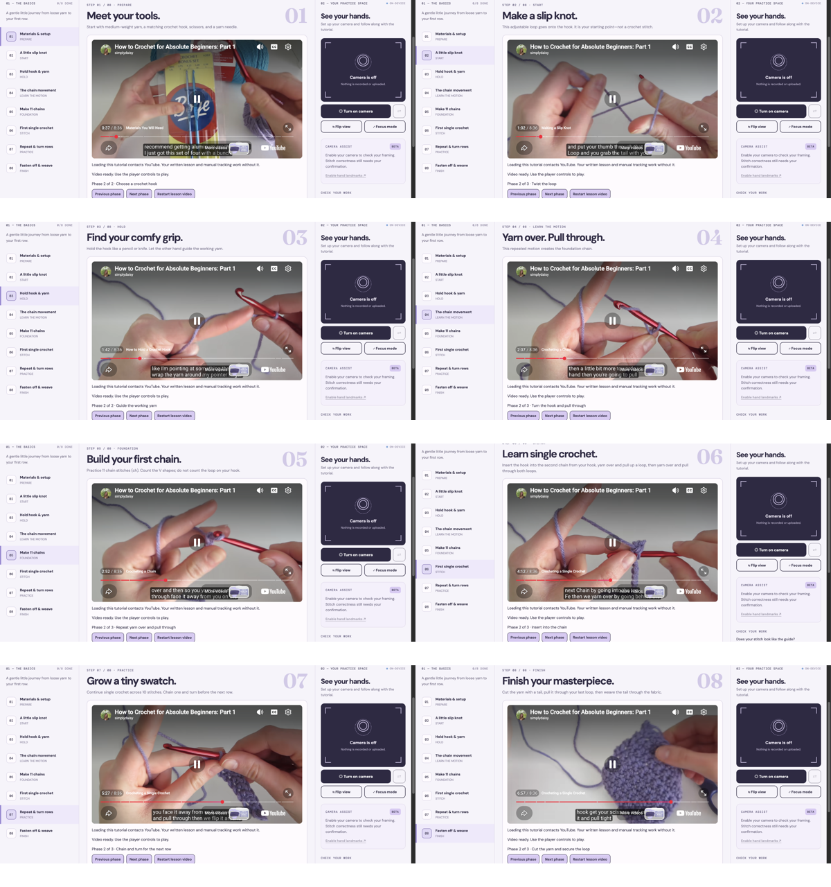

# Course video playback evidence

Local static build at `http://localhost:8766/`, Google Chrome on macOS. The screenshot captures each lesson after selecting its second phase and playing the real YouTube embed:

Observed positions in lesson order: 37.8, 62.0, 102.1, 127.1, 172.1, 252.1, 327.1 and 417.1 seconds. The original tutorial was also inspected directly for the remaining mapped phases and segment transitions.

- Before consent, network inspection showed no YouTube requests; the written lesson and manual controls remained available.
- The player cued paused, and phase selection stayed paused. Manual counting during playback advanced the counter without resetting video time. Opening the journal and pausing the session stopped playback.
- Two lesson positions (chain 175.15 s and knot 63.67 s) restored independently after navigation and reload, paused after loading. The manually counted chain and journal survived reload. Reset cleared both progress and video positions.
- Playback past the materials segment ended at 53 s without completing the lesson; pressing Play restarted at its 23 s beginning.
- Blocking the iframe API produced the unavailable message and timestamped YouTube link; lesson navigation and manual counting remained usable.
- At 390 px with reduced motion enabled, the player started paused, phase controls were keyboard-operable, the iframe had a descriptive title, and no horizontal overflow was observed. Desktop was also inspected.

The separate direct `youtube.com/embed` navigation showed error 153 without an embedding origin; the actual localhost embed played. The browser's native WebMCP testing API was unavailable in this session. No camera permission was requested.
