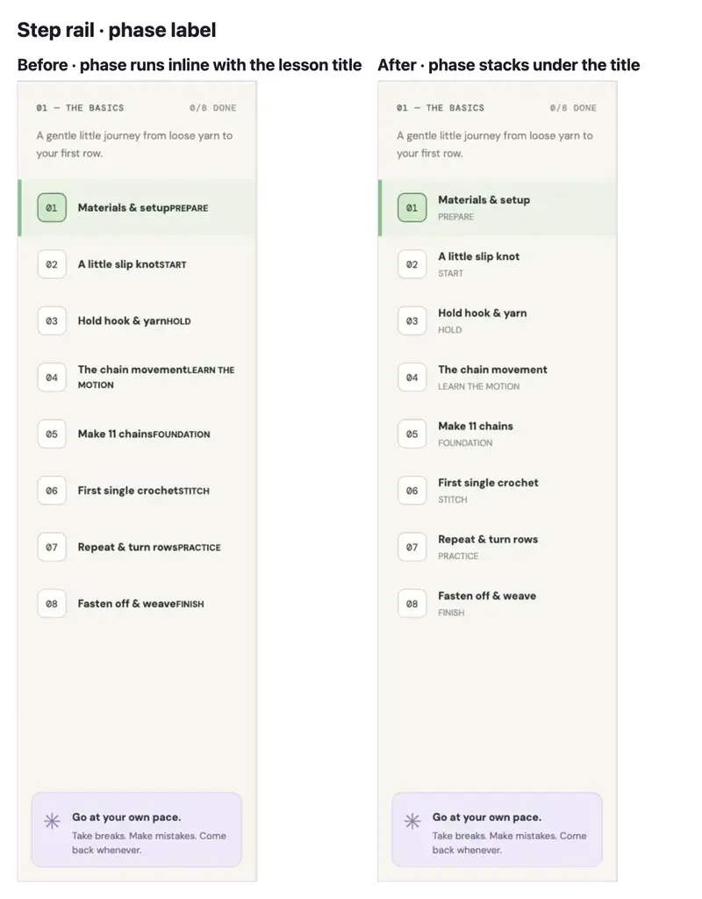
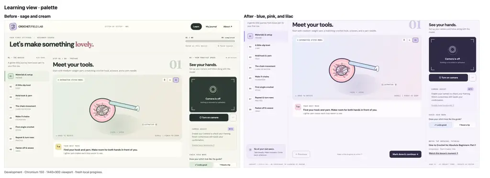
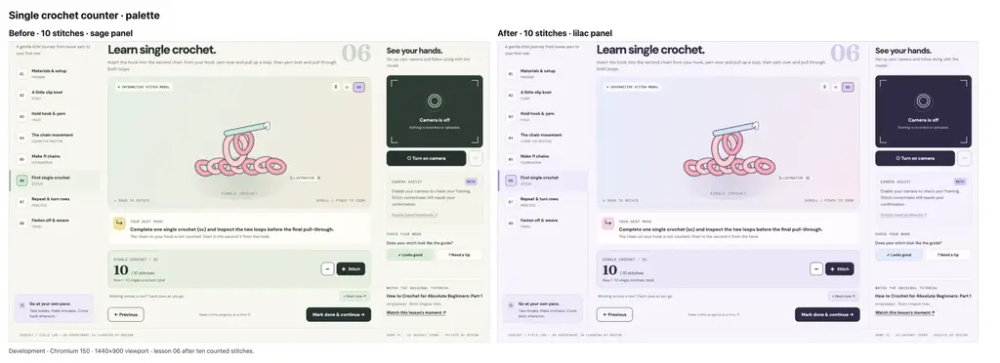
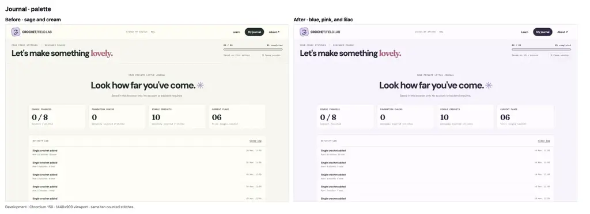
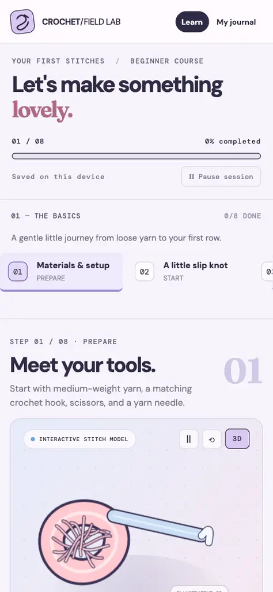
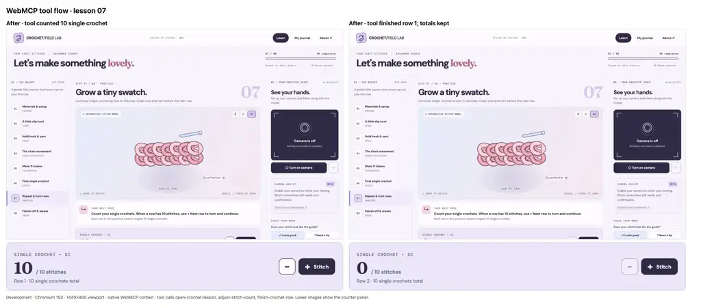
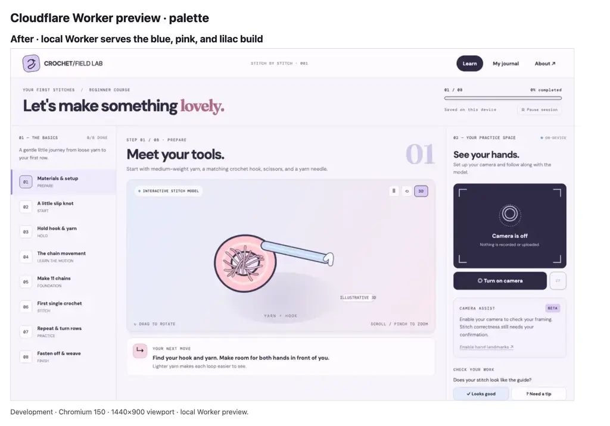

# E2E evidence: WebMCP tools, palette retheme, and Worker deployment

Environment:
- Product environment: Development
- Branch: `main`
- Commit: `b31820b` (this evidence commit adds only the document and images)
- Primary surface: local static development server, route `/`
- Secondary surface: local Cloudflare Worker preview, route `/`
- Client configuration: Chromium 150; 1440×900 desktop viewport; 390×844 phone viewport
- State: fresh local progress unless the scenario says otherwise

## Summary

- Step rail: the lesson phase now stacks under the title and no longer overlaps it.
- Palette: the learning view, counter, journal, and phone layout use blue, pink, and lilac without green hues.
- WebMCP: eight tools register and update the visible lesson and counters.
- Assets: versioned stylesheet and module URLs return HTTP 200.
- Cloudflare: the Worker build and a local Worker preview pass. Production deployment is pending the branch connection.

## Changed-behavior coverage

| User-visible change | Evidence | Status |
| --- | --- | --- |
| Lesson phase no longer overlaps the step title | Step rail before/after composite | Passed |
| Learning view uses the new palette | Learning view before/after composite | Passed |
| Counter panel and row controls use the new palette | Counter before/after composite | Passed |
| Journal uses the new palette | Journal before/after composite | Passed |
| Phone layout uses the new palette without horizontal overflow | Phone after-only capture | Passed |
| WebMCP tools register and change lesson and counts | Tool list, DOM assertions, WebMCP composite | Passed |
| WebMCP polyfill works when native support is absent | Eight tools and one executed action with native API removed | Passed |
| Browser fetches the versioned stylesheet and modules | Resource timing entries with HTTP 200 | Passed |
| Worker build, dry run, and local preview serve the site | Build output and Worker preview composite | Passed |
| Production Worker deployment | Cloudflare branch connection is an owner action | Pending |
| Repository-local `pr-e2e-evidence` skill | Discovered from `.omp/skills` after installation | Passed (developer tooling) |

## Evidence

### Step rail label placement

Development — Chromium 150, 1440×900 viewport. Before: the phase text ran inline and touched the lesson title. After: the phase text appears on its own line under the title.

### Learning view palette

Development — Chromium 150, 1440×900 viewport, fresh progress. Before: sage and cream. After: blue, pink, and lilac.

### Counter palette

Development — Chromium 150, 1440×900 viewport, lesson 06 after ten counted stitches. The counter and row controls render on the new lilac surfaces.

### Journal palette

Development — Chromium 150, 1440×900 viewport, same ten counted stitches. The journal keeps its layout while the surfaces change palette.

### Phone palette

Development — Chromium 150, 390×844 viewport. The page has no horizontal overflow and the horizontal step rail remains usable.

### WebMCP tools and row lifecycle

Development — Chromium 150, 1440×900 viewport, native WebMCP context. The page reported eight tools. The tool calls then opened lesson 07, counted ten single crochet, and finished the row.

| Assertion | Observed |
| --- | --- |
| Registered tools | 8 |
| Lesson after `open-crochet-lesson` | 07 · Grow a tiny swatch. |
| Counter after `adjust-stitch-count` | 10 / 10, row 1 |
| Counter after `finish-crochet-row` | 0 / 10, row 2, 10 single crochet total |
| Page console errors | None |

The lower panels in the image show the counter after the count and after the row change.

Polyfill fallback: with the native context removed, the vendored polyfill registered eight tools and `open-crochet-lesson` returned an `ok` result for lesson 07. The page produced no console errors.

### Versioned assets

Development — Chromium 150. The current document requested versioned URLs, and each returned HTTP 200.

| Resource | Result |
| --- | --- |
| `styles.css?v=2` | 200 |
| `app.js?v=2` | 200 |
| `webmcp.js?v=2` | 200 |
| `vendor/webmcp-polyfill.js?v=2` | 200 |

The development server sends no `Cache-Control` header, so versioned URLs prevent an old stylesheet from surviving a palette change.

### Cloudflare Worker

Development — Chromium 150, 1440×900 viewport, local Worker preview. `npm run build` copied five entries into `dist/`. `npm run deploy:dry` read seven files, reported no bindings, and exited without publishing. The Worker preview served the new palette and eight WebMCP tools.

Production is pending. The `cf-deploy` branch is ready for the Cloudflare Workers Builds connection.

### Contrast checks

| Pair | Ratio | Result |
| --- | --- | --- |
| Ink on paper | 12.56:1 | Pass |
| Muted text on paper | 4.65:1 | Pass |
| Completed step number on lilac | 4.98:1 | Pass |
| Self-check feedback on card | 5.48:1 | Pass |
| Destructive action text on card | 5.86:1 | Pass |
| Counter note on lilac panel | 4.63:1 | Pass |
| Step subtitle on card | 3.55:1 | Below AA for small text |
| Footer on paper | 3.03:1 | Below AA for small text |

The two low ratios apply to 9–10 px labels. They are unchanged from the previous palette and need a separate accessibility fix.

## Console and network notes

- No page errors appeared on the final development page, the Worker preview, or the polyfill fallback page.
- No request failed. The versioned resources returned HTTP 200.
- Unrelated font requests did not block any scenario.

## Limitations

- The camera-on and hand-landmark overlay states were not exercised because this environment has no camera. Their palette changes were reviewed in source only.
- WebMCP was tested in Chromium 150 through the native context and the polyfill fallback. Other browsers and browser-integrated agents are untested.
- Production Worker verification is pending the Cloudflare branch connection.
- No pull request exists, so this document is the review record instead of a PR evidence block.

## Cleanup

- Temporary baseline preview servers and the local Worker preview are stopped.
- The local development server is retained for review.
- Temporary helper pages and raw captures are removed.
